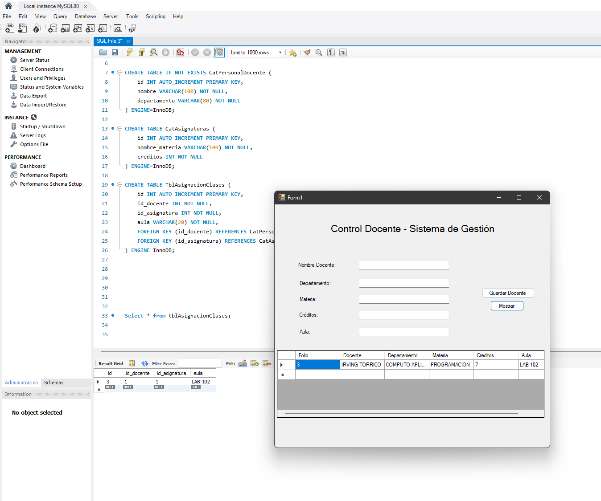
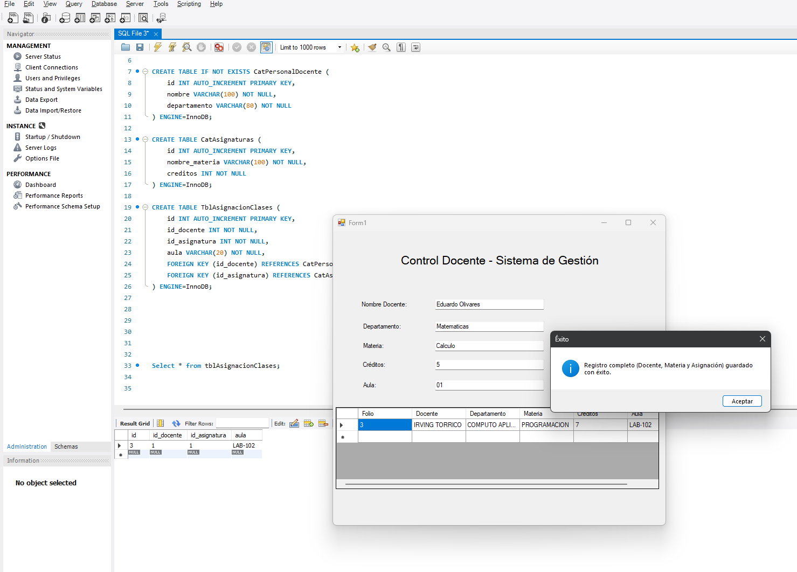
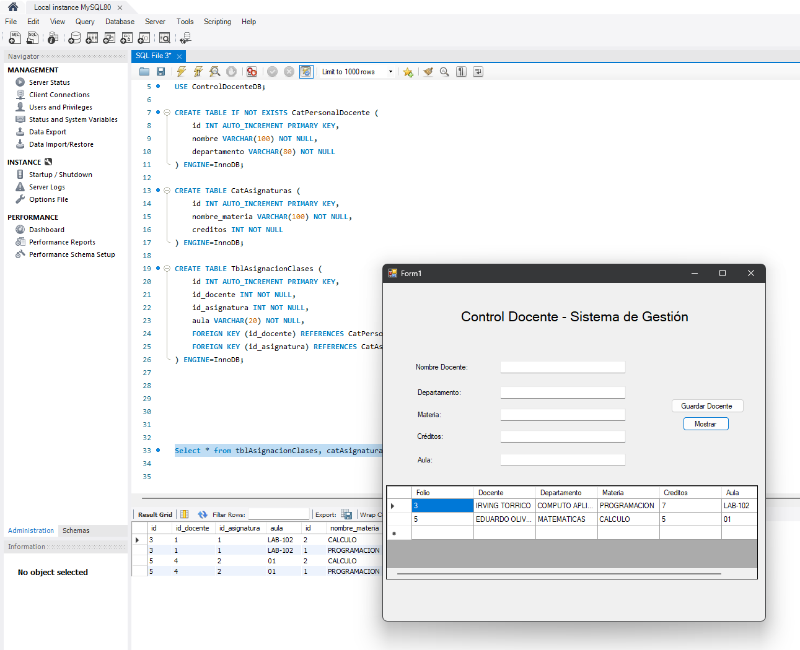

# Actividad 2: Interfaz Gráfica con Conexión a MySQL
**Materia:** Ciberinfraestructura  
**Profesor:** Ma. Inés Calderón Zetter  
**Alumno:** Irving Eduardo Torrico Olivares
**Proyecto:** Sistema de Gestión de Personal Académico y Asignaturas (`ControlDocenteDB`)

---

## 1. Descripción del Proyecto
Aplicación de escritorio desarrollada en C# conectada a una base de datos relacional MySQL (`ControlDocenteDB`). El sistema permite la gestión dinámica de carga académica universitaria asociando docentes, asignaturas y aulas.

---

## 2. Arquitectura de la Base de Datos

La base de datos se compone de 3 tablas relacionales con restricciones de clave foránea (`FOREIGN KEY` y `ON DELETE CASCADE`):

1. **`CatPersonalDocente`**: Registro de profesores y sus departamentos.
2. **`CatAsignaturas`**: Catálogo de materias y sus créditos.
3. **`TblAsignacionClases`**: Tabla relacional que vincula docentes, asignaturas y aulas asignadas.

```sql
CREATE DATABASE ControlDocenteDB
CHARACTER SET utf8mb4
COLLATE utf8mb4_unicode_ci;

USE ControlDocenteDB;

CREATE TABLE CatPersonalDocente (
    id INT AUTO_INCREMENT PRIMARY KEY,
    nombre VARCHAR(100) NOT NULL,
    departamento VARCHAR(80) NOT NULL
) ENGINE=InnoDB;

CREATE TABLE CatAsignaturas (
    id INT AUTO_INCREMENT PRIMARY KEY,
    nombre_materia VARCHAR(100) NOT NULL,
    creditos INT NOT NULL
) ENGINE=InnoDB;

CREATE TABLE TblAsignacionClases (
    id INT AUTO_INCREMENT PRIMARY KEY,
    id_docente INT NOT NULL,
    id_asignatura INT NOT NULL,
    aula VARCHAR(20) NOT NULL,
    FOREIGN KEY (id_docente) REFERENCES CatPersonalDocente(id) ON DELETE CASCADE,
    FOREIGN KEY (id_asignatura) REFERENCES CatAsignaturas(id) ON DELETE CASCADE
) ENGINE=InnoDB;
```

## 3. Evidencias de Funcionamiento (Screenshots)

### Captura 1: Estado Inicial y Consulta Relacional en Base de Datos
*(Muestra el estado inicial del sistema con los registros precargados en el DataGridView y la verificación correspondiente de la tabla de asignaciones en MySQL Workbench)*



---

### Captura 2: Captura de Datos Dinámicos y Confirmación de Registro
*(Muestra el formulario completado con el nuevo docente "Eduardo Olivares", la confirmación de éxito en pantalla y el estado de la base de datos)*



---

### Captura 3: Actualización Dinámica de la Carga Académica (INNER JOIN)
*(Muestra la consulta relacional actualizada reflejando los nuevos datos integrados de las 3 tablas en el DataGridView y su correspondiente `SELECT` cruzado en MySQL Workbench)*


